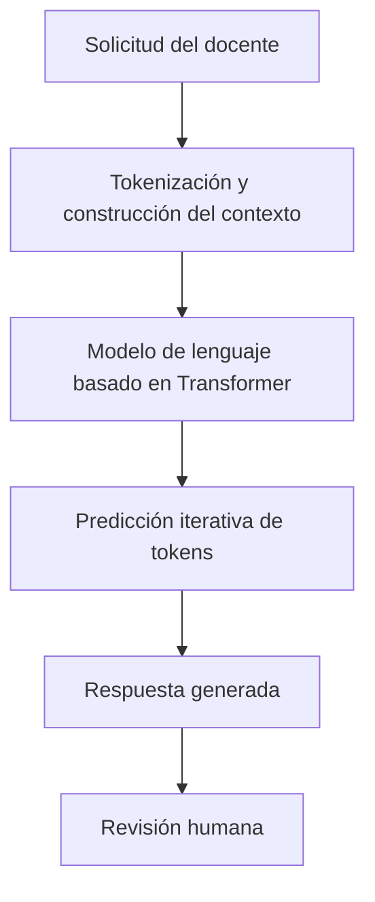
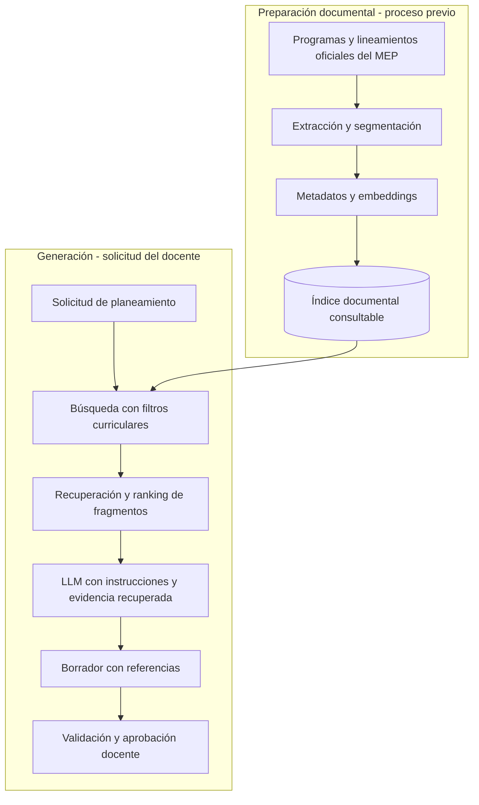
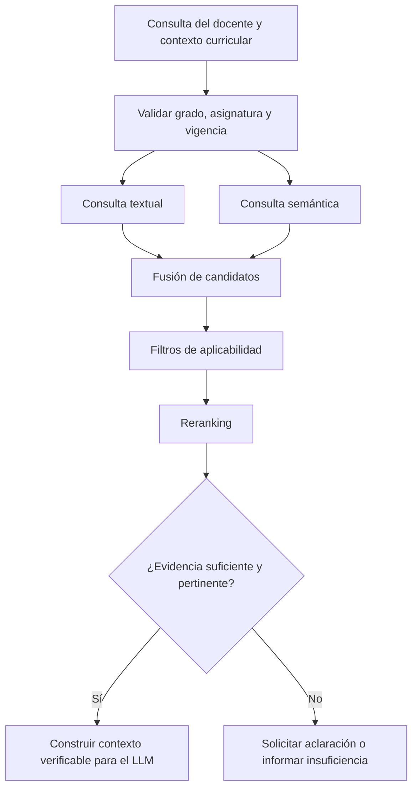
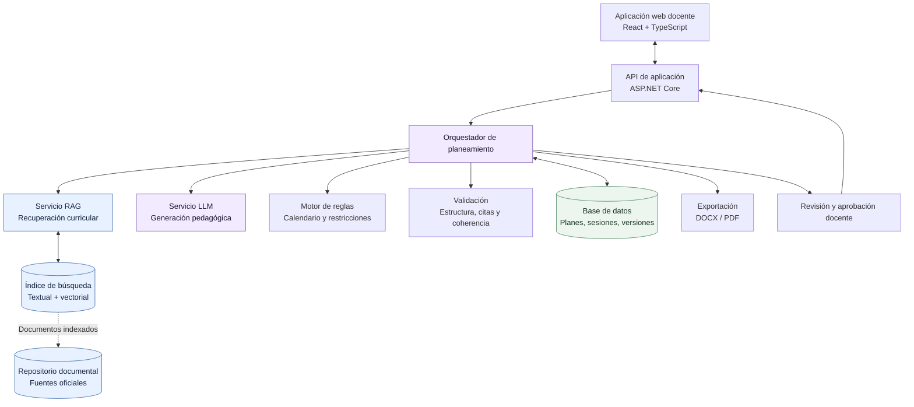
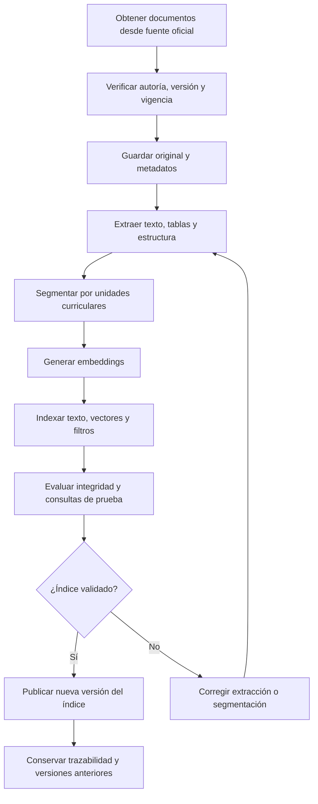
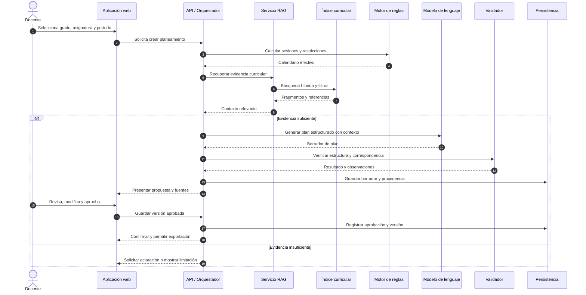
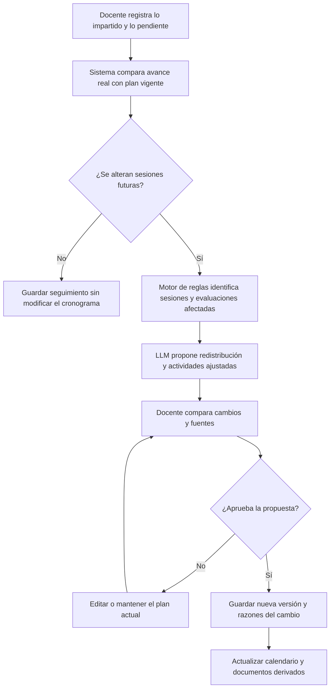
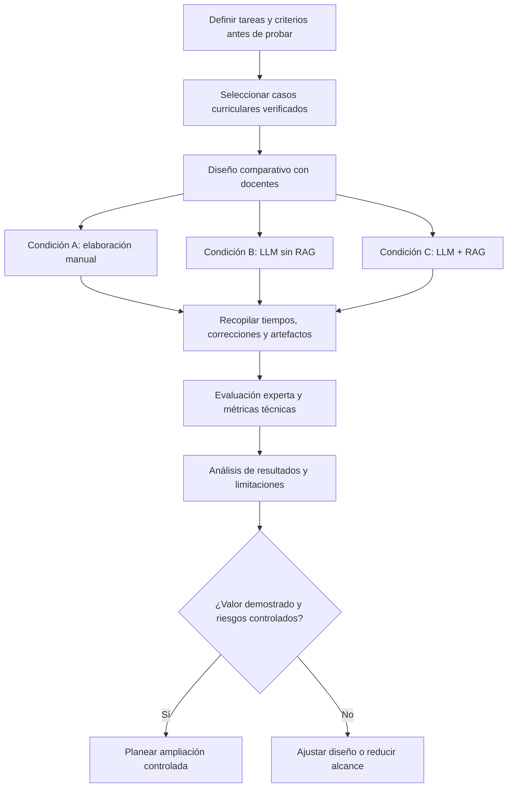

# Aplicación de LLM y RAG en una plataforma inteligente de acompañamiento docente

**Universidad CENFOTEC**  
**Maestría Profesional en Ingeniería del Software**  
**Área:** Inteligencia artificial generativa, recuperación aumentada de información y arquitectura de software educativo  
**Fecha:** octubre de 2026  
**Documento base:** *Avance I del Proyecto Final: Sobrecarga laboral y desgaste mental en personal docente* (versión 1.1).

> **Nota de alcance:** El documento base excluye expresamente la implementación de LLM y RAG del alcance del prototipo actual. Esta investigación plantea una **posible evolución arquitectónica** y no afirma que las funcionalidades descritas estén implementadas, aprobadas por el MEP ni validadas experimentalmente.

**Visualización de diagramas:** todos los diagramas se proporcionan en bloques `mermaid` editables. Se pueden previsualizar en GitHub, GitLab o en un editor Markdown que soporte Mermaid.

---

## Resumen ejecutivo

La presente investigación estudia los fundamentos científicos, tecnológicos y arquitectónicos de los modelos de lenguaje de gran escala (*Large Language Models*, LLM) y la generación aumentada mediante recuperación de información (*Retrieval-Augmented Generation*, RAG), para determinar su aplicabilidad en una plataforma de acompañamiento a docentes del sistema educativo costarricense.

El problema de partida es el tiempo que el personal docente dedica a elaborar planeamientos didácticos, preparar materiales, organizar actividades y adaptar las clases al avance real del grupo. Se propone evaluar una arquitectura en la que **RAG recupere contenidos de programas y lineamientos oficiales del Ministerio de Educación Pública (MEP)** y un **LLM elabore propuestas pedagógicas editables** a partir de esas fuentes. Un motor de reglas atendería los cálculos de fechas, duraciones y restricciones, mientras el docente conservaría la decisión y aprobación finales.

La solución podría asistir la elaboración de planes curriculares contextualizados, actividades, materiales imprimibles y reajustes de sesiones. No obstante, estas capacidades son hipótesis tecnológicas: ni RAG garantiza la fidelidad de la respuesta ni un LLM garantiza la calidad pedagógica o el ahorro de tiempo. Tales beneficios deben demostrarse con evaluaciones técnicas y pruebas de uso.

**Hipótesis de investigación:** la integración de LLM con recuperación de información curricular oficial mediante RAG podría mejorar la pertinencia, trazabilidad y utilidad de los planeamientos generados y reducir el esfuerzo de elaboración, bajo controles de validación curricular y revisión docente.

---

## 1. Fundamentos conceptuales y tecnologías involucradas

### 1.1. Inteligencia artificial, aprendizaje automático y generación de contenido

La inteligencia artificial (IA) comprende sistemas computacionales diseñados para realizar actividades asociadas con capacidades cognitivas, como reconocer patrones, procesar lenguaje y resolver problemas. El aprendizaje automático (*machine learning*) permite inferir patrones a partir de datos. El aprendizaje profundo (*deep learning*) emplea redes neuronales con múltiples capas de representación.

La **inteligencia artificial generativa** produce contenido nuevo —texto, código, imágenes y otros artefactos— a partir de representaciones aprendidas. En educación puede utilizarse para sugerir explicaciones, estructurar documentos, elaborar ejercicios o adaptar el lenguaje de recursos; pero debe someterse a criterios de calidad, privacidad y supervisión humana (Miao y Holmes, 2023).

### 1.2. Modelos de lenguaje de gran escala (LLM)

Un **LLM** es un modelo de aprendizaje profundo que procesa y genera lenguaje a partir de un contexto. Muchos LLM generativos actuales emplean la arquitectura *Transformer*, introducida por Vaswani y colaboradores (2017). Sus mecanismos de atención permiten construir representaciones contextuales de secuencias de tokens.

Entre las capacidades relevantes para el proyecto están:

- Interpretar solicitudes en lenguaje natural.
- Transformar información en estructuras como planeamientos, guías o evaluaciones.
- Proponer ejemplos y actividades didácticas.
- Resumir, reformular o extender material existente.
- Generar borradores que puedan revisar personas expertas.

Un LLM **no es una base de datos normativa**. Puede redactar una explicación fluida y aun así mencionar un contenido no vigente, atribuir incorrectamente un aprendizaje a un grado o inventar una referencia. Por ello, su generación no debe confundirse con una verificación de los documentos oficiales.

**Figura 1. Flujo conceptual simplificado de un LLM**



El diagrama es conceptual: un LLM no verifica por sí mismo que la respuesta cumpla con el currículo vigente.

### 1.3. Embeddings y búsqueda semántica

Un *embedding* es una representación numérica de un fragmento de información mediante un vector. Textos semánticamente relacionados pueden proyectarse a regiones próximas de un espacio vectorial, aunque no compartan exactamente las mismas palabras.

Una medida común de similitud es la del coseno:

$$
\operatorname{sim}(A,B)=\frac{A\cdot B}{\lVert A\rVert\lVert B\rVert}
$$

Donde $A$ y $B$ son representaciones vectoriales de dos textos. La métrica captura semejanza geométrica, **no** equivalencia normativa o pedagógica.

Por ejemplo, una consulta sobre evaporación podría recuperar material relacionado con el ciclo del agua aun cuando el docente no utilice la misma expresión que el programa. No obstante, el sistema deberá filtrar además por nivel, grado, asignatura y modalidad para evitar que un documento de otro contexto aparezca como fuente curricular aplicable.

El trabajo de Karpukhin et al. (2020) constituye una referencia fundamental para la recuperación densa de pasajes.

### 1.4. Generación aumentada por recuperación (RAG)

**RAG** es una arquitectura que combina un sistema de recuperación de información con un modelo generativo. Antes de elaborar la respuesta, recupera fragmentos de fuentes externas y los entrega al LLM como contexto. Lewis y colaboradores (2020) formularon este enfoque para tareas intensivas en conocimiento.

Una simplificación conceptual es:

$$
P(Y\mid X,D)\approx P_{\mathrm{LLM}}(Y\mid X,R(X,D))
$$

Donde $X$ es la solicitud, $D$ el conjunto documental, $R(X,D)$ los fragmentos recuperados y $Y$ la respuesta generada. La formulación original puede modelar también la distribución de documentos recuperados.

**Figura 2. Funcionamiento de RAG: preparación documental y consulta**



RAG permite aportar fuentes verificables y actualizables. **No elimina las alucinaciones**: una respuesta puede interpretar mal un fragmento, citarlo incorrectamente o introducir afirmaciones no sustentadas. Debe evaluarse la fidelidad de la respuesta y comprobarse que las citas respalden efectivamente lo afirmado.

### 1.5. Diferencia entre LLM, RAG, fine-tuning y reglas de negocio

| Tecnología | Función principal | Aplicación potencial |
|---|---|---|
| LLM | Interpretar y generar lenguaje | Proponer planeamientos, instrucciones y ejercicios. |
| Embeddings | Representar semánticamente documentos y consultas | Encontrar contenidos relacionados. |
| Índice vectorial / motor de búsqueda | Consultar representaciones y metadatos | Recuperar evidencia curricular. |
| RAG | Combinar recuperación documental y generación | Fundamentar propuestas en programas del MEP. |
| Fine-tuning | Adaptar parámetros del modelo con entrenamiento adicional | Ajustar comportamiento o formatos, si se justifica. |
| Motor de reglas | Verificar restricciones deterministas | Comprobar fechas, duraciones y requisitos formales. |
| Orquestador | Coordinar recuperación, generación y validación | Ejecutar los casos de uso completos. |

**RAG no es fine-tuning.** El primero consulta información externa en tiempo de ejecución; el segundo modifica el comportamiento del modelo mediante entrenamiento. Para documentos curriculares susceptibles de actualización, conviene comenzar con RAG y no con entrenamiento de un modelo desde cero.

---

## 2. Estado del arte de arquitecturas RAG

La investigación de Gao et al. (2024) caracteriza tres familias de arquitecturas: *Naive RAG*, *Advanced RAG* y *Modular RAG*. Otras variantes, como GraphRAG y Agentic RAG, añaden representación estructurada de relaciones o estrategias de ejecución más autónomas.

| Arquitectura | Características | Evaluación para el proyecto |
|---|---|---|
| Naive RAG | Recuperar fragmentos y transferirlos directamente al generador. | Apropiada para línea base y prueba inicial. |
| Advanced RAG | Mejoras en filtrado, recuperación híbrida, ranking y contexto. | **Primera opción para evaluación técnica.** |
| Modular RAG | Componentes especializados y reemplazables. | Útil para evolucionar hacia una plataforma completa. |
| GraphRAG | Grafos de entidades y relaciones. | Considerable si se justifican dependencias curriculares complejas. |
| Agentic RAG | Agentes que deciden consultas y uso de herramientas. | Evolución posible, con riesgos y controles adicionales. |

### 2.1. Por qué evaluar Advanced RAG

Una arquitectura de recuperación más robusta puede combinar:

1. **Búsqueda léxica:** útil para nombres, códigos curriculares y formulaciones exactas.
2. **Búsqueda semántica:** útil para consultas equivalentes expresadas de otra manera.
3. **Filtros obligatorios:** aseguran correspondencia de nivel, ciclo, grado, materia, modalidad y vigencia.
4. **Reranking:** reordena fragmentos candidatos según relevancia respecto de la solicitud.
5. **Control de suficiencia:** detiene o condiciona la generación cuando no existe evidencia suficiente.

Azure AI Search, por ejemplo, documenta la combinación de búsqueda textual y vectorial y la fusión de resultados mediante *Reciprocal Rank Fusion* (Microsoft, s. f.). Esta funcionalidad no implica que deba elegirse Azure: el patrón puede evaluarse con alternativas abiertas.

**Figura 3. Estrategia de recuperación propuesta**



La solución no debe considerar obligatoria una cita por el solo hecho de que un texto recuperado se parezca semánticamente a la solicitud. La aplicabilidad curricular debe verificarse de forma explícita.

---

## 3. Análisis del proyecto de sobrecarga docente

### 3.1. Problema y visión del producto

El documento *Avance I del Proyecto Final: Sobrecarga laboral y desgaste mental en personal docente* presenta una plataforma inteligente de acompañamiento para apoyar tareas de planeamiento, preparación de clases, actividades, evaluación y seguimiento. El estudio inicial se orienta a primaria en Costa Rica; no corresponde extrapolar automáticamente sus hallazgos a otros niveles.

El desafío de ingeniería consiste en reducir el trabajo requerido para convertir un programa curricular en sesiones, actividades y materiales concretos, preservando la autonomía profesional y la pertinencia pedagógica.

El documento plantea siete escenarios de prototipo:

- **S1:** reconocer el programa y la plantilla aplicables.
- **S2:** distribuir objetivos y contenidos según tiempo disponible.
- **S3:** incorporar condiciones generales del grupo.
- **S4:** preparar sesiones y trabajo extra-aula.
- **S5:** ubicar y revisar evaluaciones.
- **S6:** obtener un plan formal revisado.
- **S7:** ajustar el plan después de impartir una clase.

Estos escenarios ofrecen una base funcional para diseñar casos de uso que puedan ser validados posteriormente con una arquitectura LLM + RAG.

### 3.2. Necesidades expresadas en el documento

El Apéndice C recoge respuestas de cuatro entrevistas docentes. Entre las necesidades que aparecen están:

- Preparar materiales concretos y listos para imprimir, no solo enumerar ideas de actividades.
- Mostrar instrucciones, recursos y tiempos de cada actividad.
- Ajustar la secuencia cuando una sesión no se imparte.
- Continuar el planeamiento desde el avance real tras una incapacidad o sustitución.
- Mantener libertad para editar, trasladar u omitir prácticas.
- Evitar capturar información individual innecesaria del estudiantado.

Estas observaciones son insumos exploratorios del proyecto, **no una medición de eficacia ni una muestra representativa** del personal docente costarricense.

### 3.3. Correspondencia entre necesidad y tecnología

| Necesidad | Componente propuesto | Resultado verificable esperado |
|---|---|---|
| Encontrar el programa aplicable | Índice documental + RAG | Fragmentos curriculares trazables. |
| Elaborar el planeamiento | LLM + contexto recuperado | Borrador estructurado. |
| Crear actividades | LLM + reglas pedagógicas | Instrucciones, materiales y tiempos editables. |
| Producir recursos imprimibles | Generación estructurada + motor documental | Archivo revisable y exportable. |
| Respetar las fechas lectivas | Motor determinista de calendario | Sesiones efectivas sin días excluidos. |
| Retomar después de una ausencia | Estado del plan + sugerencias del LLM | Nueva secuencia desde el avance confirmado. |
| Planificar evaluaciones | RAG + LLM + validación | Correspondencia entre objetivos, práctica y evaluación. |

### 3.4. Delimitación y consistencia documental

El avance universitario declara fuera de su alcance la implementación de IA aplicada con LLM y RAG para generar planeamientos o evaluaciones. Por eso, la presente propuesta debe identificarse como **trabajo de investigación y evolución futura**, separado de las funcionalidades implementadas en el prototipo.

El documento requiere asimismo una revisión de consistencia antes de formalizar resultados: su apartado *Estado de la evidencia* afirma que no se han realizado entrevistas, pero el Apéndice C incorpora cuatro entrevistas. También conviene armonizar la relación entre el gestor de carga semanal inicialmente delimitado y el recorrido posterior de planeamiento automatizado.

---

## 4. Propuesta de arquitectura de software

### 4.1. Principios de diseño

1. **Fuente documental controlada:** los programas y lineamientos oficiales constituyen la referencia curricular consultable, no la memoria del modelo.
2. **Separación de responsabilidades:** recuperación, generación, calendario, validación y exportación operan como capacidades diferenciadas.
3. **Trazabilidad:** cada afirmación curricular relevante debe poder vincularse a una fuente y versión.
4. **Revisión humana:** un plan generado inicia en estado de borrador y requiere aprobación docente.
5. **Portabilidad:** cambiar de proveedor LLM o motor de búsqueda no debe obligar a reescribir el dominio.
6. **Privacidad desde el diseño:** minimizar los datos del estudiantado y restringir el acceso.
7. **Medición:** registrar latencia, errores, costos y correcciones necesarias para demostrar valor.

### 4.2. Arquitectura lógica de referencia

**Figura 4. Arquitectura propuesta para la plataforma**



El diagrama expresa **dependencias lógicas**, no la obligación de desplegar cada componente como un microservicio. Se recomienda comenzar con un monolito modular y extraer servicios solo cuando métricas de carga, escalabilidad o independencia operativa lo justifiquen.

### 4.3. Repositorio curricular e ingesta

El MEP publica programas de estudio y la Dirección de Desarrollo Curricular ofrece disposiciones y plantillas de planeamiento. Antes de indexarlos deben verificarse procedencia, aplicabilidad, vigencia y condiciones de reutilización.

Los documentos se almacenarán con metadatos, por ejemplo:

```json
{
  "idDocumento": "documento-oficial-001",
  "institucion": "MEP",
  "tipoDocumento": "Programa de estudio",
  "nivel": "Primaria",
  "ciclo": "II Ciclo",
  "grado": "Por determinar",
  "asignatura": "Por determinar",
  "version": "Versión verificada",
  "urlOficial": "URL del documento original",
  "fechaVerificacion": "Fecha de consulta",
  "estadoVigencia": "Pendiente de verificar"
}
```

**El ejemplo es un contrato de datos ilustrativo; no representa un documento curricular real.** Los metadatos deben ajustarse a las categorías, secciones y terminología que utilice efectivamente cada fuente.

**Figura 5. Pipeline de ingesta, indexación y actualización curricular**



Al segmentar, conviene preservar la jerarquía de encabezados, las referencias a tablas y los vínculos con indicadores o unidades curriculares. Debe evaluarse el tamaño adecuado de los fragmentos, porque una división demasiado pequeña pierde contexto y una excesivamente grande puede disminuir la calidad de recuperación.

### 4.4. Motor RAG y políticas de recuperación

El motor recibirá una solicitud estructurada que incluya, cuando corresponda, grado, asignatura, modalidad, período y contenido deseado. Primero verificará aplicabilidad y vigencia; después combinará búsqueda exacta y semántica; finalmente realizará un reranking y entregará pasajes con sus referencias.

Una política crítica es la **abstención informada**: cuando no se disponga de evidencia suficiente, la aplicación debe pedir aclaración o mostrar la limitación, en lugar de atribuir al MEP una actividad inventada.

### 4.5. Generación estructurada mediante LLM

El orquestador construirá una solicitud al modelo que incluya:

- Contexto del docente, sin datos personales innecesarios de estudiantes.
- Fragmentos curriculares recuperados y referencias.
- Restricciones del calendario ya calculadas por el sistema.
- Estructura de salida exigida.
- Instrucciones para distinguir contenidos oficiales de recomendaciones didácticas.

Ejemplo de salida estructurada:

```json
{
  "planeamientoId": "plan-001",
  "estado": "Borrador",
  "sesiones": [
    {
      "fecha": "2026-11-03",
      "duracionMinutos": 80,
      "objetivoCurricular": {
        "descripcion": "Pendiente de completar",
        "referenciaDocumento": "documento-oficial-001",
        "referenciaFragmento": "fragmento-001"
      },
      "inicio": [],
      "desarrollo": [],
      "cierre": [],
      "materiales": [],
      "evaluacion": {
        "instrumento": "Pendiente de revisar"
      }
    }
  ]
}
```

La salida debe validarse con un esquema tipado antes de guardarla. La correcta estructura JSON no basta para afirmar adecuación curricular: las referencias y relaciones pedagógicas requieren verificaciones independientes.

### 4.6. Validadores y aprobación

| Nivel | Comprobación | Método principal |
|---|---|---|
| Estructural | Tipos, campos, valores requeridos | Esquemas y reglas deterministas. |
| Temporal | Sesiones disponibles, feriados y duración | Motor de calendario. |
| Curricular | Fuente aplicable y referencias correctas | Validación de metadatos y evidencia. |
| Consistencia | Relación objetivo–actividad–evaluación | Reglas, revisión automatizada y expertos. |
| Pedagógico | Pertinencia para recursos y condiciones del grupo | Rúbrica y juicio docente. |
| Humano | Aprobación y modificaciones | Revisión explícita de la persona docente. |

Una distinción fundamental es que **el programa oficial respalda el aprendizaje exigido**, mientras que una actividad diseñada por el LLM puede ser una propuesta y no una instrucción del MEP. La interfaz debe diferenciar ambos orígenes.

---

## 5. Casos prácticos y diagramas de interacción

### 5.1. Generación inicial de un planeamiento

**Escenario ilustrativo:** una docente prepara cuatro semanas de una asignatura de primaria, con dos sesiones semanales y una fecha sin clase. Solicita contenidos de Ciencias relacionados con el ciclo del agua, **sujetos a que la correspondencia de grado y programa se verifique en la fuente aplicable**.

El sistema deberá: identificar la fuente, determinar las sesiones efectivas, recuperar evidencia curricular, generar las actividades, aplicar validaciones y permitir una revisión antes de exportar.

**Figura 6. Secuencia de generación asistida de un planeamiento**



La versión aprobada debe diferenciarse del borrador automático, conservar las modificaciones y registrar los documentos consultados.

### 5.2. Replanificación después de una clase

El documento del proyecto señala que, cuando una clase no se completa, el docente puede necesitar trasladar u omitir actividades o continuar el mes siguiente. La decisión pedagógica le corresponde al docente.

**Figura 7. Reajuste del plan según el avance real del grupo**



En esta arquitectura el LLM no modifica silenciosamente el plan aprobado. Toda reorganización relevante debe quedar disponible para revisión y versionado.

---

## 6. Selección y justificación de tecnologías

La selección definitiva requiere conocer volumen documental, presupuesto, habilidades del equipo, políticas de alojamiento y número de usuarios. Se proponen tecnologías de referencia, no una contratación predeterminada.

| Componente | Alternativa Azure / .NET | Alternativa abierta |
|---|---|---|
| Interfaz | React + TypeScript | React + TypeScript |
| API y dominio | ASP.NET Core | ASP.NET Core |
| Inferencia LLM | Modelos disponibles en Microsoft Foundry | Modelos abiertos mediante servicio de inferencia |
| Embeddings | Servicio de embeddings compatible | Modelo abierto de embeddings |
| Búsqueda | Azure AI Search | PostgreSQL + pgvector o motor especializado |
| Documentos | Azure Blob Storage | Almacenamiento de objetos S3-compatible |
| Persistencia | Azure SQL o PostgreSQL | PostgreSQL |
| Observabilidad | Azure Monitor y OpenTelemetry | OpenTelemetry y plataforma de telemetría |
| Exportación | Open XML SDK y plantillas DOCX | Bibliotecas compatibles con DOCX |

### 6.1. Estilo arquitectónico recomendado

La alternativa recomendada para la primera implementación evaluable es un **monolito modular** con las siguientes capacidades:

- GestiónCurricular.
- Planeamientos.
- GeneracionPedagogica.
- Evaluaciones.
- Documentos.
- Seguridad.
- Observabilidad.

Las interfaces de LLM y recuperación permitirían intercambiar proveedores. Los componentes solo se separarían físicamente cuando las métricas o requisitos operativos demuestren que conviene hacerlo.

### 6.2. Costo y rendimiento

El costo por operación no se reduce a los tokens del LLM. Incluye consultas, validaciones, infraestructura y regeneraciones:

$$
C_{\mathrm{operacion}}=C_{\mathrm{entrada}}+C_{\mathrm{salida}}+C_{\mathrm{recuperacion}}+C_{\mathrm{validacion}}+C_{\mathrm{infraestructura}}
$$

Deben medirse latencias de recuperación y generación, tokens de entrada y salida, número de correcciones, costo por plan aprobado y frecuencia de reutilización de contenidos. No es defendible fijar tarifas o capacidades sin seleccionar proveedor, modelo y patrón de uso.

---

## 7. Seguridad, privacidad y gobernanza

Una plataforma educativa puede llegar a tratar datos sensibles o información personal de menores. En Costa Rica, la Ley N.º 8968 establece un marco para el tratamiento de datos personales. La UNESCO (2023) recomienda un enfoque humano, seguro y atento a la privacidad para el uso de IA generativa en educación. El perfil NIST AI 600-1 y la guía OWASP para LLM aportan criterios complementarios de gestión de riesgos.

| Riesgo | Consecuencia | Control propuesto |
|---|---|---|
| Alucinación curricular | Objetivos o referencias incorrectas | Verificación de fuentes y aprobación docente. |
| Prompt injection | Instrucciones maliciosas insertadas en documentos | Separar evidencia de instrucciones; controlar entradas y salidas. |
| Filtración de información | Exposición de datos de docentes o estudiantes | Minimización, cifrado, permisos y auditoría. |
| Documento desactualizado | Uso de un programa no vigente | Versionado y verificación de vigencia. |
| Recuperación errónea | Fuente de otro grado o modalidad | Filtros curriculares obligatorios. |
| Sesgo o inadecuación pedagógica | Actividades impropias o desiguales | Rúbricas, revisión experta y corrección humana. |
| Mayor carga de revisión | Pérdida del beneficio esperado | Medir tiempo neto y descartar automatizaciones ineficientes. |
| Dependencia del proveedor | Dificultad para migrar | Contratos desacoplados y observabilidad por componente. |

Para el prototipo conviene usar datos ficticios o anonimizados. La elaboración de un planeamiento general no debe exigir nombres ni calificaciones individuales. Cualquier evolución hacia personalización individual necesitará una evaluación específica de privacidad y legitimación del tratamiento de datos.

No se debe atribuir a la solución capacidad de diagnosticar desgaste mental o producir beneficios clínicos sin investigación especializada.

---

## 8. Metodología de investigación y evaluación

### 8.1. Preguntas e hipótesis

**Pregunta principal:** ¿en qué medida la incorporación de recuperación documental RAG mejora la correspondencia curricular y el tiempo neto de elaboración de planeamientos respecto de un proceso manual o una generación mediante LLM sin recuperación específica?

**Hipótesis H1:** los planeamientos generados con LLM + RAG alcanzarán mayor correspondencia curricular que aquellos generados con LLM sin recuperación, bajo una rúbrica experta.

**Hipótesis H2:** la asistencia mediante LLM + RAG reducirá el tiempo neto de elaboración y revisión frente al proceso manual, sin disminuir la calidad pedagógica mínima requerida.

**Hipótesis H3:** la inclusión de referencias verificables facilitará la revisión y corrección docente de los planes.

Todas son hipótesis a contrastar, no hallazgos obtenidos.

### 8.2. Comparación experimental

| Condición | Procedimiento | Propósito |
|---|---|---|
| A: Manual | Elaboración con herramientas habituales | Línea base de tiempo y calidad. |
| B: LLM | Generación sin RAG curricular específico | Aislar el aporte de generación. |
| C: LLM + RAG | Generación con fuentes recuperadas y controles | Evaluar la contribución de RAG. |

Se recomienda un diseño con tareas equivalentes y orden contrabalanceado para disminuir efectos de aprendizaje. Los evaluadores de calidad deberían trabajar con rúbricas previamente definidas y, cuando sea posible, sin conocer la condición experimental de origen.

**Figura 8. Proceso de evaluación comparativa**



### 8.3. Métricas sugeridas

| Dimensión | Indicador | Interpretación |
|---|---|---|
| Recuperación | Recall@k | Porción de fragmentos relevantes entre los primeros k. |
| Ranking | nDCG@k | Calidad del orden de resultados. |
| Fidelidad | Proporción de afirmaciones sustentadas | Evaluación de afirmaciones frente al contexto. |
| Atribución | Precisión de citas | Cuántas referencias respaldan la afirmación correspondiente. |
| Currículo | Correspondencia curricular | Evaluación experta de pertinencia y aplicabilidad. |
| Contenido | Completitud y utilidad | Presencia y calidad de los elementos requeridos. |
| Rendimiento | Latencia p50 / p95 | Experiencia bajo condiciones operativas definidas. |
| Economía | Costo por plan aprobado | Costo total de obtener un documento utilizable. |
| Usabilidad | Tiempo neto y correcciones | Trabajo necesario después de revisar y ajustar. |

RAGAs (Es et al., 2024) y ARES (Saad-Falcon et al., 2024) ofrecen referencias metodológicas para evaluar aspectos de recuperación y generación. Los evaluadores automáticos requieren calibración o contrastación humana y no sustituyen el juicio curricular experto.

### 8.4. Cálculo del ahorro de tiempo

El tiempo asistido debe incorporar toda la interacción:

$$
T_{\mathrm{asistido}}=T_{\mathrm{configuracion}}+T_{\mathrm{generacion}}+T_{\mathrm{revision}}+T_{\mathrm{correccion}}+T_{\mathrm{exportacion}}
$$

$$
\operatorname{Ahorro}(\%)=\frac{T_{\mathrm{manual}}-T_{\mathrm{asistido}}}{T_{\mathrm{manual}}}\times100
$$

**Ejemplo exclusivamente ilustrativo, no resultado del proyecto:**

| Modalidad | Tiempo hipotético |
|---|---:|
| Planeamiento manual | 120 minutos |
| Planeamiento asistido, incluyendo revisión | 75 minutos |
| Diferencia | 45 minutos |
| Reducción relativa | 37,5 % |

Deben definirse antes del experimento los umbrales de aceptación, los errores curriculares críticos y las condiciones mínimas de privacidad. Una reducción de tiempo acompañada de menor calidad curricular no representa necesariamente una mejora.

---

## 9. Hoja de ruta de implementación

### Fase I. Preparación documental

Seleccionar un grado, una asignatura y un conjunto limitado de documentos oficiales; verificar procedencia, vigencia y formato; preparar casos de consulta y criterios de calidad.

**Entregables:** catálogo documental verificado, contratos de metadatos, conjunto de preguntas y evidencia de referencia.

### Fase II. Prueba de concepto de recuperación

Construir el pipeline de extracción e indexación, probar búsqueda híbrida y filtros curriculares, cuantificar Recall@k y errores de aplicabilidad.

**Entregables:** índice funcional, resultados de recuperación, registro de problemas y ajustes.

### Fase III. Generación y validación

Integrar el LLM, implementar formatos estructurados, validación de fechas, revisión de referencias, persistencia de borradores y aprobación docente.

**Entregables:** caso de uso de planeamiento completo, trazabilidad y versionado.

### Fase IV. Piloto con docentes

Comparar condiciones manual, LLM y LLM + RAG; recopilar tiempos, correcciones y evaluación curricular experta.

**Entregables:** protocolo, datos de resultados, análisis de limitaciones y decisión de continuidad.

### Fase V. Evolución funcional

Solo si el piloto aporta evidencia favorable, incorporar materiales imprimibles, evaluaciones, replanteamiento de clases y mayor cobertura curricular.

**Entregables:** backlog priorizado y decisiones arquitectónicas documentadas.

---

## 10. Discusión crítica

La arquitectura propuesta combina componentes con responsabilidades diferentes:

- El **LLM** aporta flexibilidad de lenguaje, redacción y propuesta de actividades.
- **RAG** aporta acceso a contenido curricular externo, versionable y potencialmente trazable.
- Un **motor de reglas** proporciona resultados deterministas para fechas, duración y restricciones.
- La **validación** verifica estructura, referencias y consistencia.
- El **docente** conserva la autoridad pedagógica y aprueba la versión final.

Tres advertencias limitan cualquier conclusión prematura:

1. **Recuperación no equivale a comprensión correcta.** Un contexto correcto todavía puede producir una respuesta incorrecta, incompleta o mal atribuida.
2. **Pertinencia curricular no equivale a pertinencia pedagógica.** El programa establece contenidos o aprendizajes, pero la forma de enseñarlos requiere valorar recursos, condiciones del grupo y autonomía docente.
3. **Automatización no equivale a reducción neta de carga.** La revisión de resultados deficientes puede consumir más tiempo que la elaboración convencional.

El trabajo de Liu et al. (2024) sobre uso de contexto extenso y la literatura de evaluación RAG refuerzan la necesidad de diseñar pruebas y controles, en vez de asumir que agregar documentos solucionará automáticamente las limitaciones de un LLM.

---

## 11. Conclusiones y dictamen arquitectónico provisional

Desde una perspectiva de maestría en ingeniería del software, existe una **justificación técnica razonable para investigar Advanced RAG combinado con LLM** como evolución de la plataforma de acompañamiento docente. La propuesta puede organizarse en un monolito modular con recuperación híbrida, validación determinista, generación estructurada, trazabilidad curricular y aprobación humana.

No se recomienda entrenar un modelo desde cero ni introducir agentes autónomos complejos como requisito inicial. Tampoco se recomienda que la plataforma trate una salida del modelo como si fuera una disposición oficial del MEP.

La decisión de adoptar el diseño deberá quedar condicionada a evidencia favorable de correspondencia curricular, calidad pedagógica, seguridad, costo y reducción neta del esfuerzo docente.

**Línea de investigación propuesta:** *Diseño y evaluación de una arquitectura de inteligencia artificial generativa basada en RAG y LLM para la elaboración de planeamientos didácticos fundamentados en programas oficiales del Ministerio de Educación Pública de Costa Rica*.

El aporte científico consiste en la comparación experimental de distintos enfoques. El aporte de ingeniería consiste en diseñar y evaluar una arquitectura extensible y verificable. El aporte práctico sería comprobar si se pueden elaborar y mantener planeamientos con menos esfuerzo sin sacrificar calidad.

---

## 12. Bibliografía

Las referencias se presentan en un formato cercano a APA 7. Las fechas de consulta, ediciones y datos editoriales deben completarse o verificarse antes de una entrega académica formal cuando corresponda.

### 12.1. Fundamentos de LLM, Transformers y RAG

- Vaswani, A., et al. (2017). *Attention is all you need*. Advances in Neural Information Processing Systems, 30. https://arxiv.org/abs/1706.03762
- Lewis, P., et al. (2020). *Retrieval-augmented generation for knowledge-intensive NLP tasks*. Advances in Neural Information Processing Systems, 33. https://arxiv.org/abs/2005.11401
- Karpukhin, V., et al. (2020). *Dense passage retrieval for open-domain question answering*. Proceedings of EMNLP, 6769–6781. https://doi.org/10.18653/v1/2020.emnlp-main.550
- Gao, Y., et al. (2024). *Retrieval-augmented generation for large language models: A survey* [Prepublicación]. arXiv. https://arxiv.org/abs/2312.10997
- Liu, N. F., et al. (2024). *Lost in the middle: How language models use long contexts*. Transactions of the Association for Computational Linguistics, 12, 157–173. https://doi.org/10.1162/tacl_a_00638

### 12.2. Evaluación de RAG

- Es, S., James, J., Espinosa Anke, L., & Schockaert, S. (2024). *RAGAs: Automated evaluation of retrieval augmented generation*. Proceedings of EACL: System Demonstrations, 150–158. https://doi.org/10.18653/v1/2024.eacl-demo.16
- Saad-Falcon, J., Khattab, O., Potts, C., & Zaharia, M. (2024). *ARES: An automated evaluation framework for retrieval-augmented generation systems*. Proceedings of NAACL. https://doi.org/10.18653/v1/2024.naacl-long.20

### 12.3. IA responsable, protección de datos y seguridad

- Miao, F., & Holmes, W. (2023). *Guidance for generative AI in education and research*. UNESCO. https://www.unesco.org/en/articles/guidance-generative-ai-education-and-research
- National Institute of Standards and Technology. (2024). *Artificial intelligence risk management framework: Generative artificial intelligence profile (NIST AI 600-1)*. https://doi.org/10.6028/NIST.AI.600-1
- OWASP Gen AI Security Project. (2025). *Top 10 for LLM applications*. https://genai.owasp.org/llm-top-10/
- Asamblea Legislativa de la República de Costa Rica. (2011). *Ley N.º 8968: Protección de la Persona frente al Tratamiento de sus Datos Personales*. https://www.imprentanacional.go.cr/gaceta/?date=05%2F09%2F2011

### 12.4. Documentación educativa y de arquitectura

- Ministerio de Educación Pública de Costa Rica. (s. f.). *Programas de estudio*. https://mep.go.cr/programas-estudio
- Ministerio de Educación Pública, Dirección de Desarrollo Curricular. (2026). *Curso lectivo 2026: disposiciones y plantillas de planeamiento*. https://ddc.mep.go.cr/cursolectivo.html
- Microsoft. (s. f.). *Hybrid search using vectors and full-text search in Azure AI Search*. Microsoft Learn. https://learn.microsoft.com/en-us/azure/search/hybrid-search-overview
- Universidad CENFOTEC. (2026). *Avance I del proyecto final: Sobrecarga laboral y desgaste mental en personal docente* (versión 1.1) [Documento académico proporcionado para el análisis]. Maestría Profesional en Ingeniería del Software.

---

## Anexo A. Decisiones de arquitectura por confirmar

| Decisión | Alternativas | Evidencia requerida |
|---|---|---|
| Recuperación | Léxica, vectorial, híbrida | Calidad del ranking en consultas reales. |
| Almacenamiento | Azure AI Search, PostgreSQL + pgvector, otro | Costo, operación, escala y filtros. |
| Proveedor LLM | Modelo comercial o abierto | Fidelidad, idioma, latencia, seguridad y precio. |
| Tamaño de fragmentos | Por sección, unidad o ventana semántica | Recall@k, pérdida de contexto y errores de referencia. |
| Generación | Una etapa o varias etapas controladas | Calidad frente a costo y latencia. |
| Despliegue | Monolito modular o servicios separados | Necesidades operativas demostrables. |
| Datos del alumnado | Ninguno, agregados, individualizados | Justificación legal y pedagógica. |
| Exportación | DOCX, PDF o plantilla institucional | Pruebas con formatos reales y revisión docente. |

## Anexo B. Criterios de terminación de la prueba de concepto

Una prueba de concepto no debe considerarse satisfactoria por producir texto convincente. Se propone exigir:

1. Documentos de referencia identificados, verificados y versionados.
2. Pruebas explícitas de recuperación por grado, materia y modalidad.
3. Evidencia de correspondencia entre las afirmaciones curriculares y las fuentes.
4. Registro de casos donde el sistema debe abstenerse.
5. Validación de calendario sin delegar cálculos críticos al LLM.
6. Revisión docente obligatoria y registro de versiones.
7. Medición de tiempo neto, calidad, latencia y costo.
8. Documentación de limitaciones y errores observados.

*Fin del documento.*
