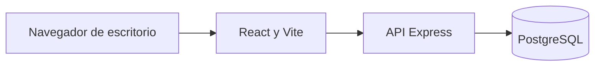
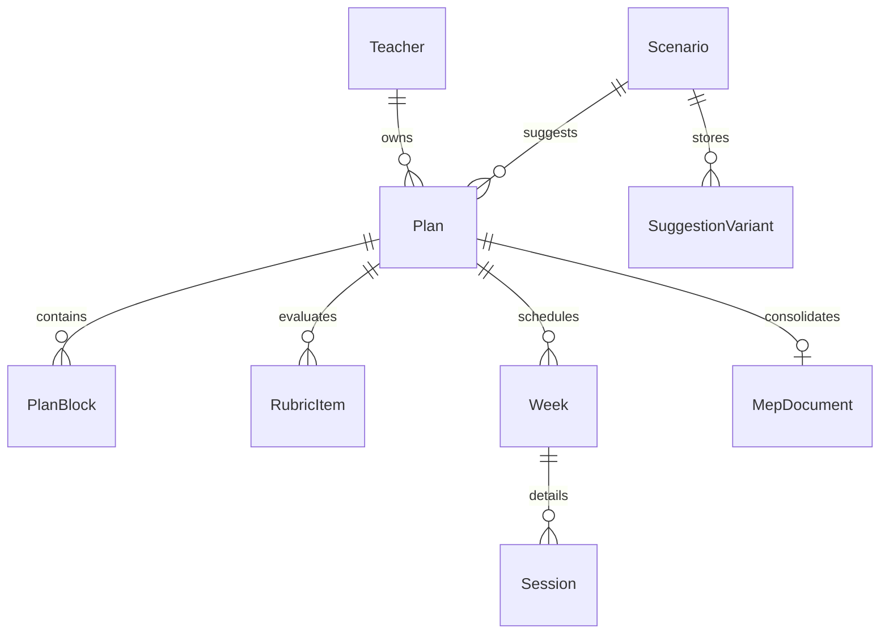

## Índice

0. [Ficha del proyecto](#0-ficha-del-proyecto)
1. [Descripción general del producto](#1-descripción-general-del-producto)
2. [Arquitectura del sistema](#2-arquitectura-del-sistema)
3. [Modelo de datos](#3-modelo-de-datos)
4. [Especificación de la API](#4-especificación-de-la-api)
5. [Historias de usuario](#5-historias-de-usuario)
6. [Tickets de trabajo](#6-tickets-de-trabajo)
7. [Pull requests](#7-pull-requests)

---

## 0. Ficha del proyecto

### 0.1. Tu nombre completo

Roger Eduardo Fonseca Montero

### 0.2. Nombre del proyecto

Planificador AI

### 0.3. Descripción breve del proyecto

Aplicación web de escritorio para que una persona docente de primaria o secundaria en Costa Rica arme su planeamiento didáctico en un wizard y descargue un PDF con formato institucional. Las sugerencias que parecen de IA salen de textos ya guardados. No hay un modelo de lenguaje.

### 0.4. URL del proyecto

https://github.com/rfonseca079/ProyectoInnovacion

### 0.5. URL o archivo comprimido del repositorio

https://github.com/rfonseca079/ProyectoInnovacion

---

## 1. Descripción general del producto

Planificador AI guía el planeamiento en nueve pasos, del contexto curricular al ajuste después de la clase. El idioma de la interfaz es español de Costa Rica. El ancho de referencia es 1440 px. No hay versión para teléfono.

Cada docente entra con correo y contraseña de una cuenta ya creada. Ve solo sus planeamientos, puede abrir uno o crear otro, y el borrador se guarda solo. Al final el sistema arma un documento tipo plantilla MEP y genera el PDF con lo que quedó guardado.

### 1.1. Objetivo

- Llevar a la persona docente por un wizard secuencial hasta un planeamiento entregable.
- Mostrar sugerencias editables dentro de cada paso, leídas de una base, para que pueda aceptarlas, editarlas o pedir otra variante ya guardada.
- Consolidar esas decisiones en un documento institucional y en un PDF.
- Permitir registrar lo ocurrido en clase y aplicar un ajuste ya definido a las sesiones y al documento.

### 1.2. Características y funcionalidades principales

Las 16 propuestas en `openspec/changes/` cubren este alcance. Ya están implementados el inicio de sesión, el cierre, la lista, la creación de un planeamiento y el borrador automático. Al salir de un campo modificado, el sistema lo guarda y el pie dice «Borrador guardado automáticamente». Si sale otra vez mientras ese guardado sigue en curso, el texto más nuevo se guarda al terminar el anterior. Las propuestas US-06 a US-16 siguen en implementación.

1. Inicio y cierre de sesión, sin registro ni recuperación de contraseña.
2. Lista de planeamientos propios, con estado y reapertura en el último paso guardado. «Aún no tiene planeamientos.» aparece solo cuando la consulta terminó y no hay filas. Si la consulta falla, el texto es «No se pudieron cargar los planeamientos.»
3. Configuración de un planeamiento nuevo y elección del escenario guardado. Si el nivel queda fuera del ciclo, se muestra «Seleccione un nivel del ciclo elegido.» y el inicio sigue deshabilitado. Un segundo clic mientras se crea no abre otro planeamiento. Si la combinación no existe, se usan las sugerencias de Matemática, 4.° año, marzo 2026, y la pantalla lo indica. Un cambio de asignatura recarga solo las tarjetas sugeridas; las aceptadas y las editadas conservan su texto.
4. Borrador automático.
5. Wizard con avance solo si el paso es válido, y reapertura de los pasos ya visitados.
6. Programa, tiempo disponible y calendario del mes.
7. Unidades del mes y rúbrica que debe sumar 100 %.
8. Diagnóstico general del grupo, sin datos sensibles del estudiantado.
9. Mediación dentro y fuera del aula.
10. Evidencias durante la clase y evaluaciones calendarizadas.
11. Cinco sesiones de la semana, con exportación de esa semana.
12. Documento institucional y descarga de PDF.
13. Ajuste después de la clase. El aviso a dirección solo se guarda: no se envía.

Cuentas de ejemplo: Juanita Pérez, Carlos Mora y María Solís. El detalle y la contraseña de demostración están en `docs/development_guide.md`.

### 1.3. Diseño y experiencia de usuario

La estructura visual y los textos de ejemplo están en `stitch.md`. Encabezado con **Planificador AI** y el contexto del planeamiento. Barra de pasos fija. Pie con **Borrador guardado automáticamente**. Las sugerencias son tarjetas dentro del paso, no un chat lateral.

### 1.4. Instrucciones de instalación

La guía está en `docs/development_guide.md`. PostgreSQL se levanta con `docker compose up -d` en el puerto de host `55432`. La API usa el `PORT` de `backend/.env` (3000 por defecto; en esta máquina el 3000 ya estaba ocupado y la verificación usó 3010). La web corre con `npm run dev` en `frontend/`.

#### Requisitos

- Node.js 20 o superior
- npm 10 o superior
- Docker Desktop, para PostgreSQL
- Git

#### Despliegue completo con Docker (recomendado)

Aún no hay `docker-compose.yml` ni imagen publicada. El despliegue previsto levanta PostgreSQL y, más adelante, la API y la web. El seed de demostración no debe correr en producción.

#### Desarrollo local (sin contenedores de app)

Cuando existan las aplicaciones, la API se prevé en `http://localhost:3000` y la web consume `VITE_API_URL`. PostgreSQL local usa la base `planificador`. Los secretos van en `.env`, no en el repositorio.

---

## 2. Arquitectura del Sistema

La arquitectura está decidida en las propuestas y en `docs/backend-standards.md` y `docs/frontend-standards.md`. El código de esas capas todavía no está creado.

### 2.1. Diagrama de arquitectura



No hay un servicio de modelo de lenguaje ni un servicio de correo.

### 2.2. Descripción de componentes principales

#### Frontend (capa de presentación)

React, TypeScript y Vite. Las páginas viven en `frontend/src/pages/` y las llamadas HTTP solo en `frontend/src/services/`. El marco común del wizard es `WizardChrome`. El ancho de trabajo es 1440 px.

#### Backend (capa de aplicación)

Node.js, TypeScript y Express, en cuatro capas: presentación, aplicación, dominio e infraestructura. Cada caso de uso, como crear un planeamiento o aplicar un ajuste, es un servicio de aplicación. Prisma habla con la base desde infraestructura.

#### Base de datos

PostgreSQL. El detalle de entidades está en `docs/data-model.md`. Los textos de sugerencia son filas de `SuggestionVariant`, tres variantes por bloque regenerable.

#### Autenticación y autorización

Correo y contraseña de cuentas sembradas. La sesión va en una cookie `httpOnly` que termina al cerrar el navegador. Cerrar sesión borra esa sesión en el servidor, limpia la cookie y vacía la lista que el navegador tenía en memoria. Atrás y recargar dejan la pantalla de acceso. El borrador guardado sigue disponible para la misma cuenta. Cada consulta de planeamiento o PDF queda limitada a la docente de la sesión. Un planeamiento ajeno responde como no encontrado.

#### Integraciones externas

No hay integraciones externas. El interruptor de aviso a dirección solo guarda su estado.

### 2.3. Descripción de alto nivel del proyecto y estructura de ficheros

```text
UserStories/          Historias originales y enriquecidas
stitch.md             Estructura visual
docs/                 Contratos, modelo y estándares
openspec/changes/     Propuestas activas y archivadas
readme_project.md     Este informe
README.md             Guía de Specboot
```

El código está en `backend/` (Express, Prisma) y `frontend/` (React, Vite).

### 2.4. Infraestructura y despliegue

#### Componentes de infraestructura

PostgreSQL, la API y la aplicación web. No hay despliegue publicado.

#### Proceso de despliegue actual

No hay proceso de despliegue. El repositorio está en GitHub. El acceso, el cierre, la lista, la creación y el borrador ya están en el código; US-06 a US-16 siguen como propuestas.

#### Separación entre desarrollo y producción

En desarrollo el seed carga las tres docentes y los tres escenarios. En producción ese seed no corre. Los secretos salen de variables de entorno.

#### Consideraciones operativas

La persona docente entra por la web. La API no se expone como producto aparte. El PDF se genera al pedirlo, a partir de lo guardado, y no reemplaza a la base como fuente de verdad.

### 2.5. Seguridad

No hay una auditoría de seguridad aparte. El acceso y la lista ya usan estos controles.

#### Hallazgos de auditoría y mitigaciones implementadas

No hay hallazgos de auditoría.

#### Controles actuales

- Contraseña solo como hash. La respuesta de acceso no incluye ese hash.
- El mismo mensaje y la misma comparación de contraseña si el correo no existe o si la contraseña no coincide. Un correo desconocido se compara contra un hash de relleno.
- Cookie de sesión `httpOnly`, sin token en `localStorage`. Cerrar sesión la invalida en el servidor y quita del navegador la lista del docente anterior.
- Consultas de planeamiento y PDF filtradas por la docente autenticada. Abrir el paso de un planeamiento ajeno muestra «No tiene acceso a este planeamiento.» y no pinta ese plan.
- El seed de demostración no corre con `NODE_ENV=production`.

#### Cómo se combinan frontend y backend

El navegador llama a la API con la cookie. Si no hay sesión, la web vuelve a la pantalla de acceso. La API sigue siendo quien decide si el planeamiento pertenece a esa docente.

#### Sesión y renovación de acceso

La sesión dura mientras el navegador sigue abierto. No hay renovación de larga duración ni recuperación de contraseña. Cerrar sesión borra la sesión del servidor, deja los borradores guardados y no muestra esa lista a la siguiente docente mientras carga la suya.

#### Bootstrap, seed y secretos de despliegue

Las cuentas y los escenarios se cargan con el seed de desarrollo descrito en `docs/development_guide.md`. `SESSION_SECRET` y `DATABASE_URL` van en `.env`.

#### Consideraciones y límites remanentes

No hay registro público, segundo factor ni envío de correo. El aviso a dirección no sale del sistema.

#### Cobertura actual por capa

El acceso, el cierre, la lista, la creación y el borrador tienen pruebas Jest, Testing Library y Playwright en escritorio de 1440 px. Las propuestas US-06 a US-16 todavía no.

#### Organización y ejecución de las suites

`npm test` en `backend/` y en `frontend/`, y `npm run test:e2e` en `frontend/`. El viewport de las pruebas de extremo a extremo es el de escritorio.

#### Pruebas de regresión

Cada cambio de OpenSpec deja sus pruebas junto al comportamiento que agrega. Antes de integrar un cambio mayor, corren las suites de API y de web.

#### Limitaciones y consideraciones actuales

Las suites de US-01 a US-05 ya se ejecutaron. US-06 a US-16 todavía no tienen implementación que cubrir.

---

## 3. Modelo de Datos

El modelo completo está en `docs/data-model.md`. Resumen de lo ya definido:

### 3.1. Diagrama del modelo de datos



### 3.2. Descripción de entidades principales

- **Teacher.** Cuenta sembrada: nombre, correo, hash de contraseña, centro y dirección regional.
- **Plan.** Planeamiento de una docente. Guarda el contexto curricular, el paso actual, el paso más alto visitado, el estado (`DRAFT`, `READY_FOR_DELIVERY`, `ADJUSTED`) y el escenario asociado.
- **Scenario.** Paquete de contenido. La clave es curso lectivo, asignatura, nivel y mes. Los tres paquetes son `mat-4-marzo-2026`, `esp-2-abril-2026` y `cie-7-febrero-2026`. El primero también es el respaldo.
- **SuggestionVariant.** Texto o JSON de un bloque, variantes 1 a 3.
- **PlanBlock.** Texto vigente del bloque y su estado: sugerido, aceptado o editado.
- **Week, Session, CalendarDay, RubricItem, Evidence.** Semanas, sesiones, marcas de calendario, rúbrica y evidencias.
- **MepDocument.** Documento institucional ya armado. Las ediciones de ese documento son las que salen en el PDF.

---

## 4. Especificación de la API

El contrato está en `docs/api-spec.yml`. La base local prevista es `http://localhost:3000`. Los mensajes visibles a la docente van en español. Los nombres de campos y los códigos de error van en inglés.

| Método y ruta | Uso |
| --- | --- |
| `POST /api/auth/login` | Abre la sesión |
| `POST /api/auth/logout` | La cierra |
| `GET /api/auth/me` | Devuelve la docente actual |
| `GET /api/plans` | Lista solo sus planeamientos |
| `POST /api/plans` | Crea uno desde la configuración |
| `GET /api/plans/{planId}` | Abre el último paso guardado |
| `PATCH /api/plans/{planId}` | Guarda un fragmento del borrador |
| `POST /api/plans/{planId}/steps/{step}/continue` | Avanza si el paso es válido |
| `POST /api/plans/{planId}/blocks/{blockKey}/accept` | Acepta la sugerencia visible |
| `PATCH /api/plans/{planId}/blocks/{blockKey}` | Edita el bloque |
| `POST /api/plans/{planId}/blocks/{blockKey}/regenerate` | Pasa a la siguiente variante |
| `POST /api/plans/{planId}/actions/{actionKey}` | Ejecuta un botón con nombre, como reanalizar o redistribuir |
| `POST /api/plans/{planId}/adjustments/apply` | Aplica el ajuste guardado |
| `GET /api/plans/{planId}/document/pdf` | PDF institucional |
| `GET /api/plans/{planId}/weeks/{weekNumber}/pdf` | PDF de las cinco sesiones |

Un campo vacío en el acceso responde 400. Un correo o contraseña incorrectos responden 401, con el mismo mensaje y una comparación de hash en ambos casos. Un planeamiento ajeno responde 404 con «No tiene acceso a este planeamiento.». Un paso inválido o un PDF incompleto responden 422. Una redistribución sin distribución guardada para esa cantidad de rubros responde 409.

---

## 5. Historias de Usuario

Cada archivo de `UserStories/` conserva la historia original y una versión enriquecida con campos, rutas y definición de terminado.

| ID | Historia | Propuesta |
| --- | --- | --- |
| US-01 | Iniciar sesión | `openspec/changes/archive/2026-10-15-us-01-iniciar-sesion` |
| US-02 | Cerrar sesión | `openspec/changes/archive/2026-10-15-us-02-cerrar-sesion` |
| US-03 | Ver mis planeamientos | `openspec/changes/archive/2026-10-15-us-03-listar-planeamientos` |
| US-04 | Crear un planeamiento | `openspec/changes/archive/2026-10-15-us-04-crear-planeamiento` |
| US-05 | Guardar el borrador | `openspec/changes/archive/2026-10-15-us-05-guardar-borrador` |
| US-06 | Recorrer el wizard | `openspec/changes/us-06-recorrer-el-wizard` |
| US-07 | Programa y calendario | `openspec/changes/us-07-revisar-programa-y-calendario` |
| US-08 | Unidades y evaluación | `openspec/changes/us-08-organizar-unidades-y-evaluacion` |
| US-09 | Diagnóstico del grupo | `openspec/changes/us-09-registrar-diagnostico-del-grupo` |
| US-10 | Mediación | `openspec/changes/us-10-definir-mediacion` |
| US-11 | Evidencias | `openspec/changes/us-11-definir-evidencias` |
| US-12 | Sesiones | `openspec/changes/us-12-preparar-sesiones` |
| US-13 | Formato MEP | `openspec/changes/us-13-consolidar-formato-mep` |
| US-14 | PDF | `openspec/changes/us-14-descargar-pdf` |
| US-15 | Ajuste después de la clase | `openspec/changes/us-15-ajustar-despues-de-la-clase` |
| US-16 | Sugerencias simuladas | `openspec/changes/us-16-usar-sugerencias-simuladas` |

---

## 6. Tickets de Trabajo

Cada propuesta es el ticket de esa historia. Dentro tiene `proposal.md` (por qué), `specs/` (comportamiento), `design.md` (cómo) y `tasks.md` (pasos).

Tres tickets representativos del corte previsto:

1. **Backend, US-01.** Acceso con cuentas sembradas, cookie de sesión y el mismo error para correo desconocido y contraseña incorrecta. Cambio: `us-01-iniciar-sesion`. Implementado.
2. **Frontend, US-03.** Lista con el estado en español, reapertura en el paso guardado, y la frase de lista vacía solo después de una consulta exitosa sin filas. Si la consulta falla, el texto es «No se pudieron cargar los planeamientos.». Cambio archivado: `2026-10-15-us-03-listar-planeamientos`. Implementado.
3. **Cierre de sesión, US-02.** `POST /api/auth/logout` responde 204, el planeamiento guardado permanece y la lista en memoria se vacía antes de que entre otra docente. Cambio: `us-02-cerrar-sesion`. Implementado.

US-04 y US-05 también quedaron implementados. Las propuestas de US-06 en adelante siguen sin implementar. El trabajo publicado está en `main`.

---

## 7. Pull Requests

No hay pull requests abiertos. El 1 se cerró porque su commit ya estaba en `main`. Se fusionaron el 2 (https://github.com/rfonseca079/ProyectoInnovacion/pull/2), el 3 (https://github.com/rfonseca079/ProyectoInnovacion/pull/3) y el 4 (https://github.com/rfonseca079/ProyectoInnovacion/pull/4). El repositorio remoto es https://github.com/rfonseca079/ProyectoInnovacion y su rama predeterminada es `main`.
